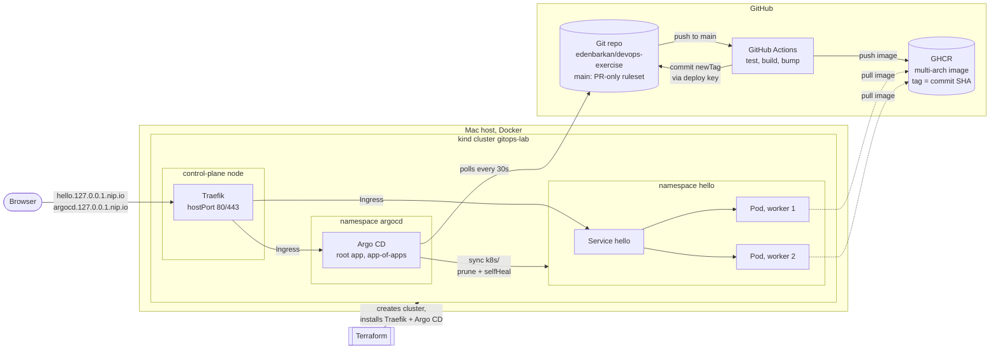
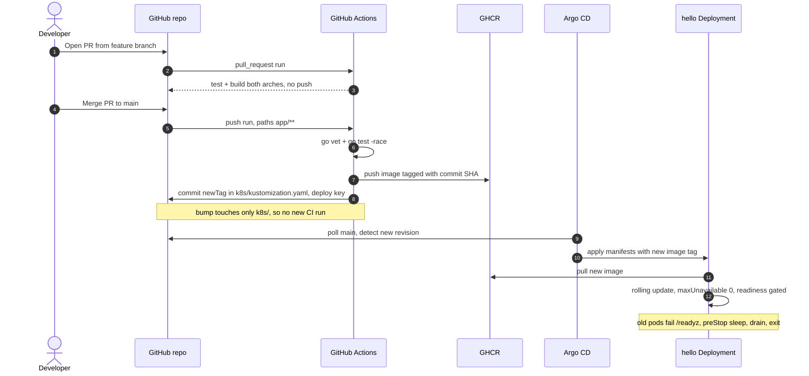

# devops-exercise: local Kubernetes with GitOps

A Go web app deployed to a local kind cluster by Argo CD. Terraform builds the
cluster and its add-ons; GitHub Actions builds the image and commits the new
tag to git; Argo CD rolls it out. Nothing outside git ever touches the cluster.

## Architecture



## Delivery flow



## Repository layout

| Path | Contents |
|---|---|
| `app/` | Go server (`/`, `/healthz`, `/readyz`), tests, multi-stage distroless Dockerfile |
| `terraform/` | kind cluster (1 control plane + 2 workers), Traefik, Argo CD, root Application |
| `argocd/` | Applications managed by the root app (app-of-apps) |
| `k8s/` | Kustomize manifests: Deployment, Service, Ingress, PDB; CI edits `newTag` here |
| `.github/workflows/ci.yaml` | test -> build/push -> tag bump |
| `scripts/rollout-check.sh` | Zero-downtime probe |

## Running it

Prerequisites: Docker (4 CPU / 8 GB), Terraform >= 1.16, kubectl. Ports 80/443
on 127.0.0.1 must be free.

```bash
cd terraform
terraform init
terraform apply          # ~1.5 min warm, ~5 min on first image pulls
```

Then:

- App: <http://hello.127.0.0.1.nip.io> (nip.io resolves to 127.0.0.1; no `/etc/hosts` edit)
- Argo CD: see below
- kubectl: `kubectl --context kind-gitops-lab get pods -n hello`

`terraform destroy` removes everything; a following `apply` rebuilds the
cluster and Argo CD redeploys the app from git with no manual steps (verified).

### Argo CD UI

Argo CD is exposed through the same Traefik Ingress at
<http://argocd.127.0.0.1.nip.io> (plain HTTP, bound to 127.0.0.1 only;
`server.insecure=true` because TLS would terminate at the ingress).

```bash
# user: admin
terraform -chdir=terraform output -raw argocd_admin_password_cmd | sh
```

The UI shows the `root` app and the `hello` app it manages: sync status, the
live resource tree, rollout history and diffs against git. Manual edits in the
cluster are reverted by `selfHeal`, so changes belong in a PR.

If the Ingress is unavailable, port-forward instead:

```bash
kubectl --context kind-gitops-lab -n argocd port-forward svc/argocd-server 8080:80
# http://localhost:8080
```

After first login, change the admin password (User Info -> Update Password) and
delete `argocd-initial-admin-secret`. Production would disable the local admin
and use SSO with AppProject RBAC.

## Shipping a change

1. Branch, edit (e.g. the message in `app/main.go`), open a PR. CI runs tests
   and builds both architectures without pushing.
2. Merge. On `main`, CI pushes `ghcr.io/edenbarkan/devops-exercise:<sha>` and
   commits `chore(k8s): deploy image <sha>` to `main`.
3. Argo CD picks the commit up within ~30s and rolls the Deployment.

`main` is protected by a ruleset: PRs only, no force push, no deletion, no
admin bypass. The only bypass is the CI deploy key (see decisions).

## Zero downtime

What makes the rollout safe:

- `RollingUpdate` with `maxUnavailable: 0`, `maxSurge: 1`, `minReadySeconds: 5`.
- Separate probes: liveness `/healthz`, readiness `/readyz`. On SIGTERM the app
  flips `/readyz` to 503, then `http.Server.Shutdown` drains in-flight requests.
- `preStop: sleep 5` (native sleep action; distroless has no shell) so Traefik
  stops routing before the process exits; `terminationGracePeriodSeconds: 30`.
- 2 replicas spread across both workers, PDB `minAvailable: 1`.

Proof: `scripts/rollout-check.sh` polled the app every 0.2s while a message
change went from PR merge to rollout. Result: **1376 requests, 0 non-200**;
the log shows version `2347520` -> mixed -> `9f8723f` and the pod names
changing from the old ReplicaSet to the new one.

## Key decisions and tradeoffs

- **Traefik, not ingress-nginx.** ingress-nginx was retired in March 2026 and
  gets no security patches. Traefik still serves plain `Ingress` resources as
  the brief asks. Production would use Gateway API.
- **Traefik reports `127.0.0.1` as the Ingress address.** On kind its Service
  never gets a load-balancer address, so Argo CD kept the app `Progressing`
  forever. `publishedService` is off and `ingressEndpoint.ip` is set instead.
- **Root app via the `argocd-apps` chart, not `kubernetes_manifest`.**
  `kubernetes_manifest` needs the Argo CRDs at plan time and fails on a fresh
  cluster.
- **Helm provider configured from the `kind_cluster` resource.** Fine for a
  single local state; in production the cluster and add-ons belong in separate
  states.
- **Deploy key for the tag bump.** Personal repos can't list GitHub Actions as a
  ruleset bypass actor (org-only), so a write deploy key (`DEPLOY_KEY` secret)
  is the single exemption. Deploy-key pushes do retrigger workflows, so the
  `paths: app/**` filter is what prevents a CI loop (verified: the bump commit
  starts no run).
- **Immutable SHA tags, never `latest`;** multi-arch images (the Mac is arm64,
  runners are amd64) cross-compiled without QEMU.
- **Supply chain:** actions pinned to commit SHAs, least-privilege
  `permissions`, provenance and SBOM attached, base images pinned by digest.
- **Hardened pod:** non-root UID 65532, read-only root filesystem, no privilege
  escalation, all capabilities dropped, `RuntimeDefault` seccomp, no service
  account token. Requests 50m/64Mi, limits 200m/128Mi (CPU limits can throttle;
  kept because the brief requires limits).
- **Local Terraform state,** gitignored; `.terraform.lock.hcl` committed;
  host ports bound to 127.0.0.1 only so the cluster isn't exposed on the LAN.

## Production on EKS

- **Infra:** separate Terraform states for network, cluster and add-ons; S3
  backend with native `use_lockfile`; Karpenter or managed node groups across 3 AZs.
- **Ingress and DNS:** AWS Load Balancer Controller or Gateway API, ACM TLS,
  ExternalDNS.
- **Identity and secrets:** EKS Pod Identity; External Secrets from Secrets
  Manager; GitHub OIDC to AWS instead of static keys.
- **Images:** ECR with immutable tags and scanning; cosign signing verified at
  admission.
- **Delivery:** environment promotion by PR through Kustomize overlays or
  ApplicationSets; Argo CD in HA with SSO and AppProject RBAC; webhooks instead
  of polling.
- **Policy and observability:** PSA `restricted` or Kyverno, NetworkPolicies,
  HPA on real metrics, Amazon Managed Prometheus and Grafana.
